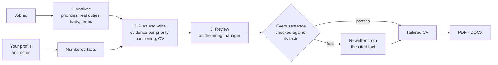
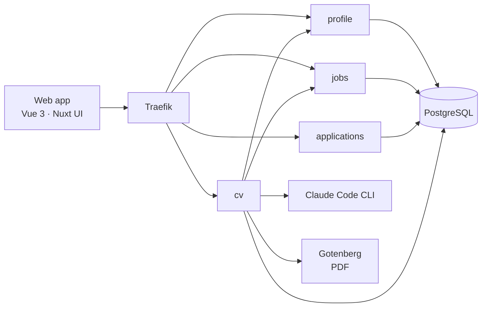

<p align="center">
  <picture>
    <source media="(prefers-color-scheme: dark)" srcset="docs/images/logo-dark.svg">
    
  </picture>
</p>

<p align="center"><strong>Job search with a CV tailored to each job, written only from what you have done.</strong></p>

<p align="center">
  <a href="https://github.com/CosminMilica/hoply/actions/workflows/ci.yml"></a>
  <a href="https://github.com/CosminMilica/hoply/actions/workflows/quality.yml"></a>
  
  
  
</p>

---

Most CVs are sent as they are, or stuffed with keywords. Hoply does what a good career coach would: it reads the
job ad, works out what the company really needs, picks the strongest proof from your experience, and writes a
one-page CV around it, in the company's own words. It never invents a skill, a number or a result.

## What it does

| | |
| --- | --- |
| **Profile** | Everything a recruiter or a screening system asks for: roles with highlights and results, projects, education, certifications, languages, work preferences. |
| **Add a job** | Paste a link or the ad's text. Hoply reads it, from the public APIs of Greenhouse, Lever, Ashby, SmartRecruiters and Workable, from structured data, or from the page itself, and finds the requirements, the responsibilities, the place and the level. |
| **Match** | Every requirement is matched, close or missing. Matching understands other names and umbrella terms: GitHub Actions proves CI/CD. It also knows close tools: FluxCD is close to Argo CD. |
| **Prepare your CV** | Asks only what the job needs and your profile does not show yet. Your answers become notes that the CV is written from. |
| **Tailored CV** | Claude analyzes the job, plans the evidence for each of its priorities, writes the CV and then reviews it as the hiring manager. Every sentence cites the facts it rests on, and code checks them. |
| **ATS check** | Twelve checks a screening system cares about: keywords in sentences, mirrored responsibilities, action verbs, numbers, dates, length. |
| **Export** | A one-column PDF and a Word DOCX with standard headings and real text, readable by any applicant tracking system. |

## How a CV is written



A sentence is thrown away when it names a number its facts do not hold, a requirement you do not have, or the
company you are applying to as your employer. A close tool may appear only beside the one you use, as experience
that carries over ("FluxCD GitOps carries over to Argo CD"), and never in the skills list. Without Claude, a rules
engine writes the CV, and the page says so. The rules behind the prompts, and their sources, are in
[docs/cv-writing.md](docs/cv-writing.md).

## Architecture



| Service | Owns | Contract |
| --- | --- | --- |
| `profile` | the person's profile and notes | [docs/api/profile.md](docs/api/profile.md) |
| `jobs` | the jobs a person adds, and reading ads from links and text | [docs/api/jobs.md](docs/api/jobs.md) |
| `applications` | saved, CV ready, applied, skipped | [docs/api/applications.md](docs/api/applications.md) |
| `cv` | questions, job analyses, CVs written asynchronously, PDF and DOCX | [docs/api/cv.md](docs/api/cv.md) |

The services are Go 1.27 with chi, pgx and goose migrations. The web app is Vue 3 with Vite, Nuxt UI, TanStack Query
and zod. The project is generated and kept up to date with [forge](https://github.com/cchifor/forge)
(`deploy/forge/stack.yaml`).

## Run it

You need Docker and, for development, Go 1.27 and Node 26.

```bash
git clone https://github.com/CosminMilica/hoply.git
cd hoply
docker compose -f docker-compose.yml -f docker-compose.dev.yaml up --build -d --wait
```

Open http://app.localhost. Without a Claude token the rules engine writes the CVs.

### Connect Claude

Hoply runs Claude through the Claude Code CLI with a subscription token, the way you use Claude yourself:

```bash
npx -y @anthropic-ai/claude-code@2.1.322 setup-token
(umask 077 && pbpaste > deploy/compose/secrets/claude_oauth_token)
curl -s http://app.localhost/api/cv/v1/writer    # "state": "ok"
```

The token file is gitignored and read on every CV, so nothing needs a restart. A subscription token is for its
owner's own use: before anyone else uses Hoply, switch to an API key. See [docs/claude-setup.md](docs/claude-setup.md).

## Develop

```text
apps/frontend/        the web app (features: profile, jobs, applications, cv)
services/profile/     Go service: the profile
services/jobs/        Go service: jobs and reading ads
services/applications/ Go service: what you did with each job
services/cv/          Go service: questions, analysis, writing, checks, export
  internal/grounding/prompts/   the prompts and the answer schemas
deploy/               compose, the forge stack, secrets (gitignored)
docs/                 contracts, plans, design, CV writing rules
scripts/forge.sh      runs the pinned forge build
```

Every change passes the same gates locally and in CI: architecture, unit, integration and end-to-end suites in
every service and in the web app, and coverage above 80% on the changed lines.

```bash
scripts/forge.sh --quality architecture --project-path .
scripts/forge.sh --quality test --project-path .
scripts/forge.sh --quality coverage --project-path . --base-ref origin/main
```

Tests never call Claude: a fake CLI returns recorded answers, including the real envelopes of the pinned CLI
version in `services/cv/tests/testdata/claude/`.

## Status

| Done | Next |
| --- | --- |
| Profile, adding jobs from links and text, matching, saved jobs and applications | Finding jobs from job boards |
| CVs tailored by Claude in three steps, checked sentence by sentence | An evaluation set to tune the prompts on more people and jobs |
| PDF and DOCX export, ATS checks | CVs in Romanian |

The design lives in [docs/design/](docs/design/), and the plan for the cv service in
[docs/plans/2026-11-25-cv-service.md](docs/plans/2026-11-25-cv-service.md).
