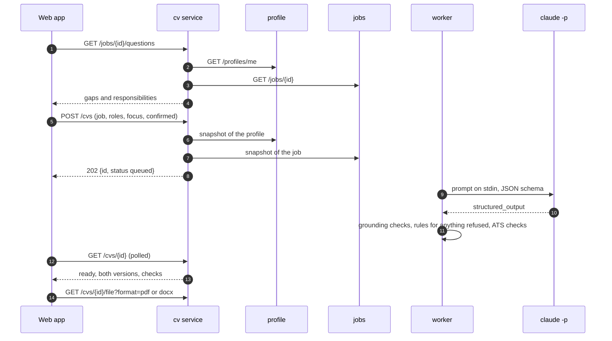

# Plan: the cv service

Status: phases 0 to 3 done and the prompt tuned, 2026-11-25. Next: phase 4.

The last mocked part of Hoply becomes a real service: it prepares the questions for a job, writes a CV tailored to that
job with Claude, checks it, and exports PDF and DOCX. Claude is reached the way `work/reviewer` does it: the Claude Code
CLI in print mode, authenticated with a subscription token, no API key.

## Decisions

| Question | Decision |
| --- | --- |
| Model | Sonnet 5.5 (§5.5) |
| PDF engine | Gotenberg (§7) |
| CV language | English only for now (§8) |
| Who uses Hoply | the owner only, while it runs on the subscription token; the `api` writer comes before anyone else (§5.4) |

## 1. Constraints that shape the design

| Constraint | Consequence |
| --- | --- |
| Anthropic's terms: subscription OAuth is for the subscriber's own use; a product serving other people must use API keys and must not route their requests through a subscription ([legal and compliance](https://code.claude.com/docs/en/legal-and-compliance), [authentication](https://code.claude.com/docs/en/authentication)) | The subscription token is for the owner's own use while Hoply has one user. The model call sits behind a `Writer` interface with two implementations; switching to an API key before anyone else uses Hoply is a configuration change (§5.4). |
| `--bare` (which skips CLAUDE.md, hooks, skills, plugins and MCP) does not read `CLAUDE_CODE_OAUTH_TOKEN` ([headless](https://code.claude.com/docs/en/headless#start-faster-with-bare-mode)) | Isolation comes from flags plus an empty working directory and an empty `HOME` (§5.2), not from `--bare`. |
| `ANTHROPIC_API_KEY`, `ANTHROPIC_AUTH_TOKEN` and `CLAUDE_CODE_USE_*` outrank the OAuth token ([precedence](https://code.claude.com/docs/en/authentication#authentication-precedence)) | The child process gets a scrubbed environment: only `PATH`, `HOME`, `CLAUDE_CODE_OAUTH_TOKEN`, `DISABLE_AUTOUPDATER=1`. |
| Subscription usage limits (session and weekly windows) | Generation is queued and runs one at a time; on a limit the CV is still produced by the rules (§6) and the person is told when Claude is available again. |
| The model can invent facts | Every sentence it writes must cite profile facts, and code verifies it (§4). Nothing unverified reaches the CV. |
| Job ads are untrusted web text | No tools for the model, the ad is fenced as data in the prompt, and the output is validated; an injected instruction can at worst change wording, never add facts. |
| The profile is personal data sent to Anthropic | The person is told once, in the Prepare CV screen, that Claude writes the CV from their profile. |

## 2. Shape

```text
services/cv/                    Go, added with forge like jobs and applications
  internal/cvdoc/               the rules engine: questions, both CV versions, ATS checks (phase 1)
  internal/upstream/            reads the profile and the job from their services (phase 1)
  internal/worker/              one worker in the process; the queue is the cvs table, FOR UPDATE SKIP LOCKED (phase 1)
  internal/writer/              Writer interface; claudecli (subscription), rules (no model); apiwriter later
  internal/grounding/           fact catalogue, citation and claim checks
  internal/render/              HTML template (PDF via Gotenberg), DOCX writer
  prompts/                      system prompt and JSON schema, versioned
libs/go/skills/                 the skills dictionary shared by jobs and cv (moved out of jobs, phase 2)
deploy/compose/secrets/         claude_oauth_token (gitignored), mounted as a compose secret
```



The web app sets the application to `cv_ready` after a CV is ready, as it does today.

## 3. API (`docs/api/cv.md`, written in phase 1)

The mock's contract (`docs/api/mocked.md`) stays, with generation made asynchronous and files added:

| Method | Path | Response |
| --- | --- | --- |
| GET | `/api/v1/jobs/{job_id}/questions` | 200 `PrepQuestions` (as today) |
| POST | `/api/v1/cvs` | 202 `Cv` with `status: queued` |
| GET | `/api/v1/cvs?job_id=` | 200 `{ items: [Cv] }`, newest first |
| GET | `/api/v1/cvs/{id}` | 200 `Cv`; `status` is `queued`, `writing`, `checking`, `ready` or `failed` |
| GET | `/api/v1/cvs/{id}/file?format=pdf\|docx` | the file, `Content-Disposition` with `file_name` |
| DELETE | `/api/v1/cvs/{id}` | 204 |

Phase 1 added `status` and `updated_at` to `Cv`. The written parts are `null` until the CV is ready, and the
snapshot of the profile stays in the database only. The Generating screen derives its step from `status`. Phase 2
adds `written_by` (`claude` or `rules`), `model`, `limit_until` (when Claude was unavailable) and `refused` (how
many sentences the checks replaced).

## 4. Grounding: how invented facts are kept out

1. **Fact catalogue.** From the profile snapshot the service numbers every fact: each highlight (text + result), each
   project highlight, each additional-information line, certifications, education, languages, role and project
   metadata. Ids are stable within one generation (`E2.B3`, `P1.B1`, `A4`, `C1`).
2. **What the model returns** (enforced with `--json-schema`): a summary and, per role and project, bullets, each as
   `{ text, facts: [id] }`; an ordering of the person's skills; nothing else. Name, contact, dates, companies, schools and
   headline are never written by the model: the code fills them from the profile.
3. **Checks per sentence** (code, deterministic):
   - every cited id exists and belongs to that role or project;
   - every number in the sentence appears in the cited facts;
   - every skill, tool or technology named (skills dictionary) is in the person's known skills (profile skills, role
     and project tools, highlight tags);
   - no organisation name that is not in the profile;
   - length limits, no first person, starts with a verb (the last two only lower the ATS score).
4. A sentence that fails is replaced with the rules engine's rewrite of its cited facts and counted in `refused`. The
   CV never shows an unchecked sentence.

## 5. Calling Claude

### 5.1 The command

```text
claude -p --output-format json --json-schema <schema>
       --model <CV_MODEL> --effort <CV_EFFORT>
       --tools "" --strict-mcp-config
       --no-session-persistence --system-prompt-file prompts/cv-system.md --max-turns 3
```

Prompt on stdin (profile facts, the job, the person's choices). The result is read from `structured_output`; a run
with `is_error: true` or without `structured_output` is a failure ([headless](https://code.claude.com/docs/en/headless#get-structured-output)).
The exact envelope is confirmed with one real run in phase 2 and pinned in a test fixture.

### 5.2 Isolation

- Working directory: an empty temporary directory per run (no CLAUDE.md to discover).
- `HOME`: an empty directory owned by the service (no user settings, skills or MCP servers).
- Environment: scrubbed as in §1. The token is read from the secret file at the point of use and is never logged,
  never in argv, never in an error message.
- Deadline (default 180 s) with SIGTERM, then SIGKILL; stdin capped well under the CLI's 10 MB.

### 5.3 Errors

| Seen in the result or stderr | Meaning | Action |
| --- | --- | --- |
| `Failed to authenticate`, `OAuth token has expired`, `revoked` | token dead | rules for this CV; health reports `claude: login needed`; the owner runs `claude setup-token` again |
| `session limit`, `weekly limit`, a reset time | usage limit | rules for this CV, `limit_until` set from the reset time; the queue skips Claude until then |
| model not available | configuration | rules; health reports it |
| deadline, crash, invalid output | transient | one retry, then rules |

The patterns start from `work/reviewer` (`src/reviewer/llm/errors.py`) and are pinned with fixtures.

### 5.4 Writers

| Writer | When | Notes |
| --- | --- | --- |
| `claudecli` | `CV_WRITER=claude-cli` and a token file | phase 2 |
| `rules` | always available; fallback | today's engine, ported from the mock |
| `api` | before Hoply has users other than the owner | official Go SDK (`anthropic-sdk-go`), structured outputs; not in this plan's phases |

### 5.5 Model

Default `CV_MODEL=claude-sonnet-5-5`, `CV_EFFORT=high` (decided 2026-11-25). The task is narrow: rewrite the person's
own facts for one job, with a schema and the grounding checks doing the strict part, so a lighter model is enough and
goes further within the subscription's limits. Phase 4 compares effort levels on the eval set; Opus 5.5 is tried only
if the refusal rate or the eval scores show Sonnet falls short.

### 5.6 Image

Multi-stage: the Go build, then a Node slim runtime with `@anthropic-ai/claude-code` pinned
(`CLAUDE_CODE_VERSION` build argument, bumped deliberately), the binary, `DISABLE_AUTOUPDATER=1`, a non-root user.

## 6. Without Claude

The rules writer is the engine the web app uses today, ported to Go: it reorders and rewrites the person's own bullets
with the job's words and never invents. It runs when the writer is `rules`, when the token is missing or dead, during
a usage limit, and for every sentence the checks refuse. The CV page shows "Written by Claude" or "Written without AI",
and the reason.

## 7. Export

- **PDF:** the CV as HTML from a Go template that matches the web app's CV paper, rendered by a Gotenberg container
  (Chromium) into a text PDF: one column, standard headings, selectable text. Gotenberg runs in compose with no
  published port; only the cv service reaches it. One template serves the PDF and stays close to the in-app preview.
- **DOCX:** a small WordprocessingML writer in Go (headings, paragraphs, bullets, one section), built from the same
  document; no third-party library.
- File name as today: `<Name>_CV_<Company>.pdf|docx`.

## 8. Language

Every CV is in English for now. A Romanian ad is still read: its skills map to the dictionary's English names, and
the system prompt tells Claude to write in English whatever the ad's language. The rules writer only borrows English
wording from the ad, so a Romanian ad leaves the person's bullets as they are. A Romanian CV is a later change: a
`language` field on the request, a second heading set in the templates.

## 9. Phases

| Phase | Delivers | Done when |
| --- | --- | --- |
| 0. Tooling | `scripts/forge.sh` installing the pinned forge build; the gates in GitHub Actions | the gates run from a clean clone and in CI |
| 1. Service on rules | `services/cv` via forge; `libs/go/skills`; questions and the rules writer ported from the mock with its tests; the async API and queue; `docs/api/cv.md`; the web app off the last mock | the CV flow works end to end with no MSW; the Generating screen follows the real status |
| 2. Claude | the `claudecli` writer, grounding checks, fallback, the token secret and its setup guide, health, the "written by" line | a real run on the owner's profile produces a grounded CV; dead token and usage limit fall back to rules (tested with a fake CLI) |
| 3. Export | Gotenberg in compose, the HTML template, the DOCX writer, the file endpoint, Download PDF/DOCX | both files open, text is selectable, the ATS checks pass on them |
| 4. Quality | an eval set (5–10 anonymised profiles × jobs), the refusal rate, effort levels compared (Opus 5.5 only if Sonnet falls short) | defaults chosen on measurements, recorded here |

### Steps

**Phase 0. Tooling**
1. `scripts/forge.sh`: installs `generator_requirement` from `.forge/quality.json` once per pin under
   `~/.cache/hoply/` (outside the repo: the architecture gate scans every file in it) and runs forge with the given
   arguments.
2. CI was already generated by forge (`ci.yml`: Go lint, tests, govulncheck; `quality.yml`: every gate with the
   pinned forge), and both failed since the first push:
   - `quality.yml`: `forge --quality install` runs `npm ci` at the workspace root, which had no lock. Fixed with
     `forge --quality lock`: a root `package-lock.json`. `apps/frontend/package-lock.json` stays for the Docker build.
   - `ci.yml`: `go 1.27.0` in `go.mod` installed Go 1.27.0, whose standard library has known vulnerabilities. Fixed
     with `toolchain go1.27.4` in every service; jobs also moves to `golang.org/x/net` v0.63.0.
   - the frontend e2e suite needs MSW, switched on by `apps/frontend/.env.development`, which `.gitignore` left out
     of the repo. Both Vite env files hold public values only and are now tracked.
3. AGENTS.md says to run forge only through the script.

**Phase 1. Service on rules** (done)
1. `cv` backend on port 5040 through `scripts/forge.sh --update`; the known side effects undone.
2. `docs/api/cv.md`.
3. `internal/upstream`: profile and jobs over HTTP (`PROFILE_SERVICE_URL`, `JOBS_SERVICE_URL`); an unknown job
   is 404, a failing service 503.
4. `internal/cvdoc`: the web app's engine ported to Go, with its tests case for case (`tests/unit/cvdoc_test.go`).
5. Migration 00100: one `cvs` table that is also the queue. `Recover` at startup puts CVs left in `writing` or
   `checking` back in the queue, or fails them after 3 attempts.
6. The routes of §3 except `/file`.
7. Web app: generation is asynchronous (POST, then poll every second). The Generating screen shows the lower of
   its animation and the service's status. The CV page shows the newest ready CV. The MSW mock is gone. The old TS
   engine is the tests' in-memory cv service (`src/test/cv-service.ts`).
8. Compose passes the services' URLs to cv; `init-db.sh` creates the `cv` database.

Deviations from the plan: the queue is the `cvs` table instead of a second table; there is no `step` field;
the skills dictionary moves in phase 2, where the grounding checks need it, because the rules engine works on
the job's requirements alone.

**Phase 2. Claude** (done)
1. `internal/claude`: the CLI runner (§5.1–5.3), with the CLI's own envelopes for "not logged in" and an invalid
   token recorded from 2.1.322 in `tests/testdata/claude/`, and synthetic ones for success and a usage limit.
2. `internal/grounding`: the fact catalogue, the prompt and schema (`internal/grounding/prompts/`), the checks
   (§4.3) and the assembly that puts the rules in place of a refused sentence.
3. `internal/writer`: Claude, one retry, then the rules; it remembers a usage limit and a dead login.
4. `cvs` gains `written_by`, `model`, `refused`, `rules_reason`, `limit_until` (migration 00101); the CV page
   says who wrote it and why.
5. `GET /api/v1/writer` reports `ok`, `off`, `no_token`, `login_needed` or `usage_limit`.
6. Image on `node:26-slim` with `@anthropic-ai/claude-code@2.1.322`. Compose mounts
   `deploy/compose/secrets/` (gitignored) at `/run/secrets/hoply/`.
7. `docs/claude-setup.md`.
8. Live run on the owner's profile and the Linear job: written by Claude in 16 s, nothing refused. The CLI's real
   success envelope (a neutral prompt, no personal data) is `tests/testdata/claude/success-2.1.322.json`.

Deviations from the plan:
- The skills dictionary stays in jobs. The skill check refuses the job's requirements that the profile does not
  show, which is the claim that matters, so the cv service does not need the whole dictionary.
- No `--disallowedTools "*"`: `--json-schema` answers through the CLI's own StructuredOutput tool, which the
  denylist blocks (the first live run got no structured output). `--tools ""` already removes every built-in tool.
- 2.1.322 has no `--system-prompt-file` or `--max-turns`, so the system prompt goes in `--system-prompt`. With
  no tools there is only one turn.
- The token comes from a mounted directory, not a compose file secret, so a missing token does not stop
  `docker compose up`.
- The organisation check covers only the company being applied to. Finding other organisation names needs more
  than rules; phase 4 measures whether it matters.

**Phase 3. Export** (done)
1. Gotenberg 9.4.0 in compose, internal network only (`GOTENBERG_URL`).
2. `internal/render`: the HTML template, the Gotenberg client and the DOCX writer, from one `CvDocument`.
3. `GET /cvs/{id}/file?format=pdf|docx&version=tailored|profile`; Download PDF and DOCX on the CV page, for the
   version on screen.
4. Checked by hand on the owner's CV: the PDF's text, extracted with pypdf, reads in order with diacritics; macOS
   `textutil` opens the DOCX. Automated tests cover the HTML, the DOCX parts and XML, and the Gotenberg client against
   a fake server. CI has no Gotenberg, so the PDF's own text is not checked there.

Found while checking: the owner's PDF runs to two pages while "Fits on one page" passes (it counts characters), and
the skills line lists all 50 skills. Both go to the prompt work.

**The prompt** (done; measured on the owner's three saved jobs, one live run each)

| Run | ATS (spektr, Linear, Publicis) | Pages | Skills listed | Sentences refused |
| --- | --- | --- | --- | --- |
| baseline | 9, 9, 8 | 2, 2, 2 | 52–54 | 1 |
| final | 10, 10, 10 | 1, 1, 1 | 18–20 | 0 |

What changed:
- The ATS checks measure what they say: present-tense verbs from a wide verb list count, the title compares
  words without punctuation, an ad without responsibilities passes that check, and "fits" estimates rendered lines
  (calibrated on real PDFs) against one page under eight years of experience, two from then on.
- The prompt says who reads the CV and why, gives a budget per section, the job's spelling of its terms, and the
  rules in `docs/cv-writing.md` (from five articles the owner chose).
- Claude chooses the skills (at most 20, every matched requirement kept) and the projects; the headline stays the
  person's own.
- Prepare your CV saves answers as notes (`docs/api/profile.md`), which Claude rewrites and combines with the
  highlights; a role's fact (dates, team, industry) and the languages are facts too.
- The export uses 10 pt and tighter spacing; education takes one line an entry.
- Refusal reasons are logged (`claude sentence refused`).
- Skills match by other names, umbrella terms and close tools (`skillmap.json`). On spektr the job keywords in the
  CV went from 12 of 20 to 18 of 20, with Argo CD, GitLab CI and Datadog named as transferable from FluxCD,
  GitHub Actions and Prometheus.

What is left is the person's: the missing keywords are skills the profile does not show, and mirrored
responsibilities need answers in Prepare your CV.

**Deeper tailoring** (done, 2026-11-25): the owner found the CV only added keywords. A CV is now written in three
Claude steps: an analysis of the job ad (role, context, ranked priorities, real responsibilities, traits, terms),
kept per job in `job_analyses`; a plan (evidence per priority, responsibilities already done, equivalents for
missing tools, positioning) and the CV written from it; a hiring manager's review that rewrites the draft. The CV
page shows the positioning, the priorities and how strongly they are proven, and what the review changed. The
mirrored-responsibilities check counts the analysis's real duties that a kept sentence proves. Final run: ATS 11,
10, 11 of 12, one page each, nothing refused, 87–115 s per CV (two Claude calls, three for a new job).

**Better material: Claude asks the questions** (done, 2026-11-25). The quality ceiling was the facts: few results
or numbers. Prepare your CV now opens with Claude's questions for the job (`GET /jobs/{id}/probe`): the facts that
best prove its priorities but lack a result or scale, the priorities the facts barely touch, the traits the ad
stresses. Answers become notes of the role they are about. Asked in the background in 9–12 s, kept per person and job
for the facts as they were.

**Requirements from the analysis** (done, 2026-11-25). The rules read requirements by keyword, so practices
("Security", "SRE"), the field itself and the stack's extras landed in `must_have`. The analysis now reads them, `must`
or `nice`, and writes them back to the job; the web app starts it when a job is added. Next: an evaluation set with a
judge (C).

**Phase 4. Quality**
1. `services/cv/eval/`: 5–10 anonymised profile × job pairs. The live runs are started by hand and are never a gate.
2. Measure the refusal rate and score the CVs against a short checklist, at effort `medium` and `high`.
3. Record the defaults here.

Every phase keeps the gates: architecture, unit, integration and e2e suites, changed-line coverage above 80 % per
subject. The Claude CLI is never called in tests; a fake binary returns recorded envelopes. One live test exists, run by
hand with the token, never counted as a gate.

## 10. Risks

| Risk | Mitigation |
| --- | --- |
| Subscription use beyond the owner breaks the terms | `api` writer before any other user; noted in the README and the setup guide |
| CLI output or flags change | pinned CLI version; envelope fixtures; health check at startup runs `claude --version` |
| Usage limits during a burst | queue of one, rules fallback, `limit_until` shown |
| Latency (tens of seconds) | asynchronous generation; the existing Generating screen |
| Over-strict checks make CVs bland | `refused` measured in phase 4; checks tuned on the eval set, never removed |
| Image size (Node + CLI) | accepted for the cv service only; the other services stay slim |
