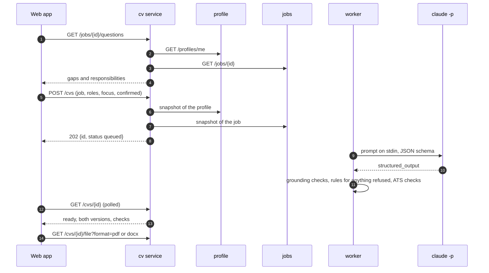

# Plan: the cv service

Status: decided, 2026-11-25. Next: phase 0.

The last mocked part of Hoply becomes a real service: it prepares the questions for a job, writes a CV tailored to that
job with Claude, checks it, and exports PDF and DOCX. Claude is reached the way `work/reviewer` does it: the Claude Code
CLI in print mode, authenticated with a subscription token, no API key.

## Decisions

| Question | Decision |
| --- | --- |
| Model | Sonnet 5.5 (§5.5) |
| PDF engine | Gotenberg (§7) |
| CV language | English only for now (§8) |
| Who uses Hoply | the owner only, while it runs on the subscription token; the `api` writer comes before anyone else (§5.4) |

## 1. Constraints that shape the design

| Constraint | Consequence |
| --- | --- |
| Anthropic's terms: subscription OAuth is for the subscriber's own use; a product serving other people must use API keys and must not route their requests through a subscription ([legal and compliance](https://code.claude.com/docs/en/legal-and-compliance), [authentication](https://code.claude.com/docs/en/authentication)) | The subscription token is for the owner's own use while Hoply has one user. The model call sits behind a `Writer` interface with two implementations; switching to an API key before anyone else uses Hoply is a configuration change (§5.4). |
| `--bare` (which skips CLAUDE.md, hooks, skills, plugins and MCP) does not read `CLAUDE_CODE_OAUTH_TOKEN` ([headless](https://code.claude.com/docs/en/headless#start-faster-with-bare-mode)) | Isolation comes from flags plus an empty working directory and an empty `HOME` (§5.2), not from `--bare`. |
| `ANTHROPIC_API_KEY`, `ANTHROPIC_AUTH_TOKEN` and `CLAUDE_CODE_USE_*` outrank the OAuth token ([precedence](https://code.claude.com/docs/en/authentication#authentication-precedence)) | The child process gets a scrubbed environment: only `PATH`, `HOME`, `CLAUDE_CODE_OAUTH_TOKEN`, `DISABLE_AUTOUPDATER=1`. |
| Subscription usage limits (session and weekly windows) | Generation is queued and runs one at a time; on a limit the CV is still produced by the rules (§6) and the person is told when Claude is available again. |
| The model can invent facts | Every sentence it writes must cite profile facts, and code verifies it (§4). Nothing unverified reaches the CV. |
| Job ads are untrusted web text | No tools for the model, the ad is fenced as data in the prompt, and the output is validated; an injected instruction can at worst change wording, never add facts. |
| The profile is personal data sent to Anthropic | The person is told once, in the Prepare CV screen, that Claude writes the CV from their profile. |

## 2. Shape

```text
services/cv/                    Go, added with forge like jobs and applications
  internal/questions/           gaps and responsibility questions for a job (ported from the mock)
  internal/cvdoc/               the CV document: build from profile + job + options (rules), the ATS checks
  internal/writer/              Writer interface; claudecli (subscription), rules (no model); apiwriter later
  internal/grounding/           fact catalogue, citation and claim checks
  internal/render/              HTML template (PDF via Gotenberg), DOCX writer
  internal/queue/               generation queue in Postgres (FOR UPDATE SKIP LOCKED), one worker
  prompts/                      system prompt and JSON schema, versioned
libs/go/skills/                 the skills dictionary shared by jobs and cv (moved out of jobs)
deploy/compose/secrets/         claude_oauth_token (gitignored), mounted as a compose secret
```



The web app sets the application to `cv_ready` after a CV is ready, as it does today.

## 3. API (`docs/api/cv.md`, written in phase 1)

The mock's contract (`docs/api/mocked.md`) stays, with generation made asynchronous and files added:

| Method | Path | Response |
| --- | --- | --- |
| GET | `/api/v1/jobs/{job_id}/questions` | 200 `PrepQuestions` (as today) |
| POST | `/api/v1/cvs` | 202 `Cv` with `status: queued` |
| GET | `/api/v1/cvs?job_id=` | 200 `{ items: [Cv] }`, newest first |
| GET | `/api/v1/cvs/{id}` | 200 `Cv`; `status` is `queued`, `writing`, `checking`, `ready` or `failed` |
| GET | `/api/v1/cvs/{id}/file?format=pdf\|docx` | the file, `Content-Disposition` with `file_name` |
| DELETE | `/api/v1/cvs/{id}` | 204 |

`Cv` gains `status`, `step` (for the Generating screen), `written_by` (`claude` or `rules`), `model`, `limit_until`
(when Claude was unavailable) and `refused` (count of sentences the checks replaced).

## 4. Grounding: how invented facts are kept out

1. **Fact catalogue.** From the profile snapshot the service numbers every fact: each highlight (text + result), each
   project highlight, each additional-information line, certifications, education, languages, role and project
   metadata. Ids are stable within one generation (`E2.B3`, `P1.B1`, `A4`, `C1`).
2. **What the model returns** (enforced with `--json-schema`): a summary and, per role and project, bullets, each as
   `{ text, facts: [id] }`; an ordering of the person's skills; nothing else. Name, contact, dates, companies, schools and
   headline are never written by the model: the code fills them from the profile.
3. **Checks per sentence** (code, deterministic):
   - every cited id exists and belongs to that role or project;
   - every number in the sentence appears in the cited facts;
   - every skill, tool or technology named (skills dictionary) is in the person's known skills (profile skills, role
     and project tools, highlight tags);
   - no organisation name that is not in the profile;
   - length limits, no first person, starts with a verb (the last two only lower the ATS score).
4. A sentence that fails is replaced with the rules engine's rewrite of its cited facts and counted in `refused`. The
   CV never shows an unchecked sentence.

## 5. Calling Claude

### 5.1 The command

```text
claude -p --output-format json --json-schema <schema>
       --model <CV_MODEL> --effort <CV_EFFORT>
       --tools "" --disallowedTools "*" --strict-mcp-config
       --no-session-persistence --system-prompt-file prompts/cv-system.md --max-turns 3
```

Prompt on stdin (profile facts, the job, the person's choices). The result is read from `structured_output`; a run
with `is_error: true` or without `structured_output` is a failure ([headless](https://code.claude.com/docs/en/headless#get-structured-output)).
The exact envelope is confirmed with one real run in phase 2 and pinned in a test fixture.

### 5.2 Isolation

- Working directory: an empty temporary directory per run (no CLAUDE.md to discover).
- `HOME`: an empty directory owned by the service (no user settings, skills or MCP servers).
- Environment: scrubbed as in §1. The token is read from the secret file at the point of use and is never logged,
  never in argv, never in an error message.
- Deadline (default 180 s) with SIGTERM, then SIGKILL; stdin capped well under the CLI's 10 MB.

### 5.3 Errors

| Seen in the result or stderr | Meaning | Action |
| --- | --- | --- |
| `Failed to authenticate`, `OAuth token has expired`, `revoked` | token dead | rules for this CV; health reports `claude: login needed`; the owner runs `claude setup-token` again |
| `session limit`, `weekly limit`, a reset time | usage limit | rules for this CV, `limit_until` set from the reset time; the queue skips Claude until then |
| model not available | configuration | rules; health reports it |
| deadline, crash, invalid output | transient | one retry, then rules |

The patterns start from `work/reviewer` (`src/reviewer/llm/errors.py`) and are pinned with fixtures.

### 5.4 Writers

| Writer | When | Notes |
| --- | --- | --- |
| `claudecli` | `CV_WRITER=claude-cli` and a token file | phase 2 |
| `rules` | always available; fallback | today's engine, ported from the mock |
| `api` | before Hoply has users other than the owner | official Go SDK (`anthropic-sdk-go`), structured outputs; not in this plan's phases |

### 5.5 Model

Default `CV_MODEL=claude-sonnet-5-5`, `CV_EFFORT=high` (decided 2026-11-25). The task is narrow: rewrite the person's
own facts for one job, with a schema and the grounding checks doing the strict part, so a lighter model is enough and
goes further within the subscription's limits. Phase 4 compares effort levels on the eval set; Opus 5.5 is tried only
if the refusal rate or the eval scores show Sonnet falls short.

### 5.6 Image

Multi-stage: the Go build, then a Node slim runtime with `@anthropic-ai/claude-code` pinned
(`CLAUDE_CODE_VERSION` build argument, bumped deliberately), the binary, `DISABLE_AUTOUPDATER=1`, a non-root user.

## 6. Without Claude

The rules writer is the engine the web app uses today, ported to Go: it reorders and rewrites the person's own bullets
with the job's words and never invents. It runs when the writer is `rules`, when the token is missing or dead, during
a usage limit, and for every sentence the checks refuse. The CV page shows "Written by Claude" or "Written without AI",
and the reason.

## 7. Export

- **PDF:** the CV as HTML from a Go template that matches the web app's CV paper, rendered by a Gotenberg container
  (Chromium) into a text PDF: one column, standard headings, selectable text. Gotenberg runs in compose with no
  published port; only the cv service reaches it. One template serves the PDF and stays close to the in-app preview.
- **DOCX:** a small WordprocessingML writer in Go (headings, paragraphs, bullets, one section), built from the same
  document; no third-party library.
- File name as today: `<Name>_CV_<Company>.pdf|docx`.

## 8. Language

Every CV is in English for now. A Romanian ad is still read: its skills map to the dictionary's English names, and
the system prompt tells Claude to write in English whatever the ad's language. The rules writer only borrows English
wording from the ad, so a Romanian ad leaves the person's bullets as they are. A Romanian CV is a later change: a
`language` field on the request, a second heading set in the templates.

## 9. Phases

| Phase | Delivers | Done when |
| --- | --- | --- |
| 0. Tooling | `scripts/forge.sh` installing the pinned forge build; the gates in GitHub Actions | the gates run from a clean clone and in CI |
| 1. Service on rules | `services/cv` via forge; `libs/go/skills`; questions and the rules writer ported from the mock with its tests; the async API and queue; `docs/api/cv.md`; the web app off the last mock | the CV flow works end to end with no MSW; the Generating screen follows the real status |
| 2. Claude | the `claudecli` writer, grounding checks, fallback, the token secret and its setup guide, health, the "written by" line | a real run on the owner's profile produces a grounded CV; dead token and usage limit fall back to rules (tested with a fake CLI) |
| 3. Export | Gotenberg in compose, the HTML template, the DOCX writer, the file endpoint, Download PDF/DOCX | both files open, text is selectable, the ATS checks pass on them |
| 4. Quality | an eval set (5–10 anonymised profiles × jobs), the refusal rate, effort levels compared (Opus 5.5 only if Sonnet falls short) | defaults chosen on measurements, recorded here |

### Steps

**Phase 0. Tooling**
1. `scripts/forge.sh`: installs `generator_requirement` from `.forge/quality.json` once per pin under
   `~/.cache/hoply/` (outside the repo: the architecture gate scans every file in it) and runs forge with the given
   arguments.
2. CI was already generated by forge (`ci.yml`: Go lint, tests, govulncheck; `quality.yml`: every gate with the
   pinned forge), and both failed since the first push:
   - `quality.yml`: `forge --quality install` runs `npm ci` at the workspace root, which had no lock. Fixed with
     `forge --quality lock`: a root `package-lock.json`. `apps/frontend/package-lock.json` stays for the Docker build.
   - `ci.yml`: `go 1.27.0` in `go.mod` installed Go 1.27.0, whose standard library has known vulnerabilities. Fixed
     with `toolchain go1.27.4` in every service; jobs also moves to `golang.org/x/net` v0.63.0.
   - the frontend e2e suite needs MSW, switched on by `apps/frontend/.env.development`, which `.gitignore` left out
     of the repo. Both Vite env files hold public values only and are now tracked.
3. AGENTS.md says to run forge only through the script.

**Phase 1. Service on rules**
1. Add the `cv` backend (port 5040, feature `cvs`) in `deploy/forge/stack.yaml` and `.forge/quality.json`, then run
   `scripts/forge.sh --update`. Undo the known side effects (lock files, `items` files, `tests/e2e/_tasks`).
2. Move the skills dictionary and its matcher from `services/jobs/internal/extract` to `libs/go/skills`; jobs imports
   it with no change in behaviour (its tests stay green).
3. Write `docs/api/cv.md`: §3 plus the shapes from `docs/api/mocked.md`.
4. Clients for profile and jobs (`internal/upstream`): read with the caller's identity; a failure becomes 502.
5. Port `features/cv/mocks/engine` to Go (`internal/questions`, `internal/cvdoc`, `internal/writer/rules`) together
   with its tests, case for case.
6. Migration 00100: tables `cvs` (request, snapshots, both documents, ATS result, status, step, timestamps) and
   `cv_jobs` (the queue). One worker in the process takes a row with `FOR UPDATE SKIP LOCKED`; rows left in `writing`
   at startup go back to `queued`.
7. Handlers for every endpoint in §3 except `/file`.
8. Web app: the cv client follows the new contract (202, poll `GET /cvs/{id}` every second until `ready` or `failed`);
   the Generating screen shows `step`; drop `features/cv/mocks` and its line in `custom/mocks/handlers.ts`; add the
   `/api/cv` proxy in `vite.config.ts`. `docs/api/mocked.md` says nothing is mocked.
9. Compose: create the `cv` database in `deploy/compose/init-db.sh`; on the running stack, `CREATE DATABASE cv` by hand.

**Phase 2. Claude**
1. `prompts/cv-system.md` and `prompts/cv-output.schema.json` (§4.2), embedded in the binary.
2. `internal/grounding`: the fact catalogue and the checks in §4.3, with table tests for each rule.
3. `internal/writer/claudecli`: §5.1–5.3. Tests run against a fake `claude` script that returns recorded envelopes:
   success, `is_error`, expired token, usage limit with reset time, timeout, invalid JSON.
4. The worker picks the writer from configuration and falls back to rules (§6); `written_by`, `refused`,
   `limit_until` are set.
5. The image: Node slim with `@anthropic-ai/claude-code` pinned, the token as the compose secret
   `claude_oauth_token`, read from `/run/secrets/`.
6. Health: `claude` shows `ok`, `no token`, `login needed` or `limited until <time>`.
7. `docs/claude-setup.md`: run `claude setup-token`, store the token in `deploy/compose/secrets/claude_oauth_token`
   with mode 0600, restart cv, and renew it before it expires (about a year).
8. The CV page shows "Written by Claude" or "Written without AI" and the reason.
9. One live run on the owner's profile and a saved job. Record its envelope as a fixture, with the personal data
   replaced.

**Phase 3. Export**
1. Gotenberg in compose (pinned image, internal network only).
2. `internal/render`: the HTML template and the DOCX writer, from one `CvDocument`.
3. `GET /cvs/{id}/file?format=pdf|docx`, then Download PDF and Download DOCX in the web app.
4. Tests: the PDF's text is extracted and the ATS checks run on it; the DOCX opens as a zip with the expected parts.

**Phase 4. Quality**
1. `services/cv/eval/`: 5–10 anonymised profile × job pairs. The live runs are started by hand and are never a gate.
2. Measure the refusal rate and score the CVs against a short checklist, at effort `medium` and `high`.
3. Record the defaults here.

Every phase keeps the gates: architecture, unit, integration and e2e suites, changed-line coverage above 80 % per
subject. The Claude CLI is never called in tests; a fake binary returns recorded envelopes. One live test exists, run by
hand with the token, never counted as a gate.

## 10. Risks

| Risk | Mitigation |
| --- | --- |
| Subscription use beyond the owner breaks the terms | `api` writer before any other user; noted in the README and the setup guide |
| CLI output or flags change | pinned CLI version; envelope fixtures; health check at startup runs `claude --version` |
| Usage limits during a burst | queue of one, rules fallback, `limit_until` shown |
| Latency (tens of seconds) | asynchronous generation; the existing Generating screen |
| Over-strict checks make CVs bland | `refused` measured in phase 4; checks tuned on the eval set, never removed |
| Image size (Node + CLI) | accepted for the cv service only; the other services stay slim |
